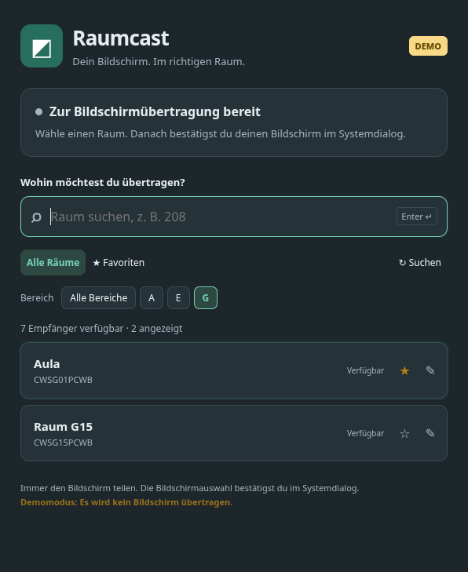

# Raumcast

Raumcast ist für Nutzerinnen und Nutzer der **CWS Usingen** gedacht. Das Tool vereinfacht die Bildschirmübertragung an die AirServer in den Unterrichtsräumen: Raum suchen, Enter drücken und den Bildschirm im Systemdialog auswählen.

Raumsuche, Anzeigenamen und Bereichsfilter sind an die Geräte- und Raumbezeichnungen der CWS Usingen angepasst. Aus technischen Empfängernamen wie `CWSR208PCWB` wird beispielsweise „Raum A208“. Räume lassen sich nach A, E oder G filtern und als Favoriten speichern. Die Zuordnungen D/RD/RE → E, RA → A und RG → G sowie reine Raumnummern → A entsprechen dieser Anpassung. Für andere Schulen oder andere Namensschemata muss die Raumerkennung gegebenenfalls geändert werden.

Die Anwendung ist ein lokaler Prototyp für Linux, Windows und macOS. Sie steuert eine eigene Chrome-/Chromium-Instanz und überträgt immer den gesamten ausgewählten Bildschirm. Der gewohnte Systemdialog zur Bildschirmauswahl bleibt erhalten.

## Downloads

Die portablen Pakete enthalten die Node.js-Laufzeit. Du brauchst zusätzlich installiertes Chrome oder Chromium und Zugang zum selben Netz wie die AirServer.

| System | Download | Start nach dem vollständigen Entpacken |
| --- | --- | --- |
| Windows x64 | [ZIP herunterladen](https://github.com/asbl/raumcast/releases/latest/download/raumcast-windows-x64.zip) | `Raumcast.cmd` |
| macOS Apple Silicon (M-Serie) | [Archiv herunterladen](https://github.com/asbl/raumcast/releases/latest/download/raumcast-macos-arm64.tar.gz) | `Raumcast.command` |
| macOS Intel | [Archiv herunterladen](https://github.com/asbl/raumcast/releases/latest/download/raumcast-macos-x64.tar.gz) | `Raumcast.command` |
| Linux x64, etwa Manjaro | [Archiv herunterladen](https://github.com/asbl/raumcast/releases/latest/download/raumcast-linux-x64.tar.gz) | `Raumcast.sh` |

[Alle Releases](https://github.com/asbl/raumcast/releases) · [SHA-256-Prüfsummen](https://github.com/asbl/raumcast/releases/latest/download/SHA256SUMS.txt)

Unter Linux kann `Installieren.sh` zusätzlich einen Startmenü-Eintrag anlegen. Den entpackten Programmordner anschließend behalten. Unter macOS und Windows können wegen der fehlenden Signierung Rückfragen des Betriebssystems erscheinen. macOS benötigt gegebenenfalls eine Bildschirmaufnahmeberechtigung für den verwendeten Browser. Die Pakete sind ein Prototyp: Die echte AirServer-Verbindung muss vor Ort getestet werden.



## Aus dem Quellcode starten

Voraussetzungen: Node.js ab Version 22, npm sowie installiertes Chrome oder Chromium mit Google-Cast-Unterstützung. Im Schulnetz müssen die AirServer per Google Cast erreichbar sein.

```sh
git clone https://github.com/asbl/raumcast.git
cd raumcast
npm ci
npm start
```

Unter Linux legt `npm run install:desktop` einen Startmenü-Eintrag **Raumcast** an. Über die GNOME-Tastatureinstellungen lässt sich anschließend optional `start-raumcast.sh` als eigenes Tastenkürzel hinterlegen.

Nach einem Umzug des Projektordners den Startmenü-Eintrag neu anlegen:

```sh
npm run install:desktop
```

Nur eine echte Raumcast-Instanz gleichzeitig öffnen: Das eigene Browserprofil kann jeweils nur von einem Browserprozess verwendet werden. Dein normaler Browser kann parallel geöffnet bleiben. Zum Beenden das Raumcast-Fenster schließen; dadurch wird auch seine Browserinstanz und damit deren Übertragung beendet.

## Bedienung

- Raumnummer oder Gerätename eingeben; Pfeiltasten wählen einen Eintrag, Enter verbindet.
- Unter „Bereich“ nach dem Raumkürzel filtern, etwa G für G01 oder E für E01. Die Kürzel stammen aus den Originalnamen und bleiben beim Umbenennen erhalten. Bereich, Textsuche und Favoriten sind kombinierbar; „Alle Bereiche“ setzt den Bereichsfilter zurück.
- Bereichszuordnung: D, RD und RE erscheinen gemeinsam unter E, RA unter A und RG unter G. Bereits vorhandene E-, A- und G-Räume gehören zum jeweiligen selben Bereich.
- Räume ohne Buchstabenkürzel gehören zu A: 208 wird als A208 angezeigt, ebenso die bisher als 208 dargestellten Empfänger mit technischem R-Präfix. Die Suche findet sowohl A208 als auch 208, auch bei einem eigenen Anzeigenamen.
- Alternativ einen Raum direkt anklicken.
- Der Stern speichert einen Favoriten; der Stift ändert den Anzeigenamen. Ein leerer Anzeigename stellt den automatisch erkannten Namen wieder her.
- `CWSR208PCWB` wird automatisch zu „Raum A208“, `CWSD32PCWB` zu „Raum E32“. Der Originalname bleibt sichtbar.
- Raum auswählen, dann den Bildschirm im gewohnten Systemdialog freigeben. Der Dialog wird nicht automatisch bestätigt.
- Während der Übertragung kannst du das Fenster minimieren. „Übertragung beenden“ beendet die eigene Sitzung.
- Geht die Erkennung eines eigenen Empfängers verloren, erscheint „Verbindung nicht bestätigt“. Das Ziel und der Stop-Knopf bleiben erhalten. Bei Wiedererkennung wird der Status erneut abgeglichen. Falls ein Stop fehlschlägt, kannst du ihn wiederholen oder Raumcast schließen.
- Ein Wechsel zu einem anderen Raum beendet zuerst die eigene alte Sitzung.
- Direkt nach dem Stop wird der Zielraum erneut auf Verfügbarkeit, Belegung und eindeutige Identität geprüft. Hat er sich inzwischen geändert, wird kein neuer Startbefehl gesendet.
- Gespeicherte Räume bleiben auch ohne Netzwerk sichtbar, sind dann aber nicht auswählbar.
- Bereits belegte oder namensgleiche Empfänger werden für neue Verbindungen gesperrt. Die Cast-Schnittstelle adressiert Empfänger beim Starten über ihren Namen.

## Demo und Tests

```sh
npm run demo
npm run check
npm test
npm run test:ui
npm start -- --smoke
```

Die Demo simuliert sieben Empfänger und überträgt nichts. Sie ist sichtbar als DEMO markiert und speichert Daten getrennt vom echten Betrieb.

Die Unit-Tests prüfen unter anderem Start/Stopp, Raumwechsel, Abbrüche, belegte und mehrdeutige Empfänger sowie gespeicherte Einstellungen. Der UI-Test startet echtes Chromium mit simuliertem Cast-Transport und prüft Suche, Favorit, Alias, Enter, Start/Stopp und Neuladen. Er speichert `artifacts/demo.png`. `--smoke` prüft Browserstart und die echte Cast-Schnittstelle ohne eine Übertragung zu starten, speichert `artifacts/live.png` und beendet die Anwendung wieder. Es ist kein vollständiger Netzwerkerkennungstest.

## Erster Test im Schulnetz

1. `npm start` ausführen und warten, bis die Raumliste erscheint.
2. Einen freien Raum mit kontrollierbarem Display auswählen.
3. Bildschirm im Systemdialog auswählen; prüfen, ob im richtigen Raum das Bild erscheint.
4. Übertragung beenden und erneut verbinden.
5. Bildschirmdialog einmal abbrechen. Falls die Anfrage weiter angezeigt wird, „Anfrage beenden“ wählen.
6. Raumwechsel und Wiederverbindung nach einem WLAN-Wechsel ausprobieren.

Wenn keine Empfänger erscheinen: Schulnetz und manuelle Cast-Erkennung im normalen Chrome vergleichen, dann „Suchen“ verwenden. Erreichbare Empfänger werden vom Browser entdeckt; Raumcast implementiert keine eigene Netzwerksuche.

Die Cast-Protokollaufrufe können während eines offenen Dialogs auf dessen Antwort warten. Währenddessen sind weitere Start-/Stoppbefehle gesperrt; bitte den Systemdialog bestätigen oder abbrechen. Ein Protokollaufruf hat ein Zeitlimit von zwei Minuten. Nach einem Fehler oder unbestätigtem Start bleibt das Ziel explizit beendbar. Im Zweifel das Raumcast-Fenster schließen.

Ist ein bereits verwendeter Empfänger inzwischen namensgleich mit einem anderen oder durch eine andere Empfänger-ID ersetzt, wird kein Stop an dieses unklare Ziel gesendet. In diesem Fall beendet das Schließen von Raumcast dessen eigene Browserinstanz. Die bekannten Fehler aus dem Audit sind behoben; Details und Regressionstests stehen in `AUDIT.md`.

## Konfiguration und Plattformen

Die Plattformlogik erkennt Chromium/Chrome unter Linux, Chrome unter Windows und Chrome/Chromium unter macOS. Ein anderer Installationspfad lässt sich über `RAUMCAST_BROWSER` angeben:

```sh
RAUMCAST_BROWSER=/usr/bin/chromium npm start
```

Unter PowerShell beispielsweise:

```powershell
$env:RAUMCAST_BROWSER = 'C:\Program Files\Google\Chrome\Application\chrome.exe'
npm start
```

Die automatische Windows-Erkennung berücksichtigt die üblichen Chrome-Installationspfade. macOS kann zusätzlich die Berechtigung zur Bildschirmaufnahme verlangen. GitHub Actions prüft die Anwendungstests sowie die entpackten Laufzeiten und Programmimporte auf Windows x64, macOS Intel und macOS Apple Silicon. Der vollständige Browser-UI-Test und der portable Browserstart werden unter Linux geprüft. Die reale Bildschirmübertragung auf Windows und macOS bleibt vor Ort zu testen. Der Startmenü-Installer ist Linux-spezifisch.

Standardverzeichnis für Browserprofil und `rooms.json`:

| System | Verzeichnis |
| --- | --- |
| Linux | `$XDG_DATA_HOME/raumcast`, sonst `~/.local/share/raumcast` |
| Windows | `%LOCALAPPDATA%\Raumcast` |
| macOS | `~/Library/Application Support/Raumcast` |

Mit `RAUMCAST_DATA_DIR` kann ein anderes Datenverzeichnis gewählt werden. Zum manuellen Bearbeiten von `rooms.json` Raumcast vorher schließen. Ein beschädigtes Einstellungsformat führt zu einer Fehlermeldung, damit keine bestehenden Daten stillschweigend überschrieben werden.

## Architektur und Grenzen

`src/main.ts` startet den Browser über Puppeteer und verbindet die lokale Oberfläche mit `src/controller.ts`. Der Controller verarbeitet Cast-Ereignisse und kontrolliert Verbindungszustände. `src/storage.ts` speichert Raumnamen, Favoriten und letzte Nutzung atomar. `ui/` enthält die Oberfläche ohne Framework.

Die Steuerung verwendet eine Prozess-Pipe, keinen offenen Debugging-Port. Die Oberfläche wird direkt aus lokalen Dateien geladen; es gibt keinen HTTP-Server. Das Browserprofil ist vom normalen Browser getrennt. Puppeteers übliche Startargumente würden MediaRouter deaktivieren; daher verwenden wir bewusst eigene minimale Startargumente.

Die CDP-Cast-Schnittstelle ist experimentell. Eine vom Empfänger gemeldete Sitzung beweist nicht, dass am Display ein korrektes Bild erscheint. Die Oberfläche sagt deshalb „Sitzung gemeldet“. Die Anwendung kann fremde Sitzungen nicht zuverlässig einem Besitzer zuordnen; sie startet keine Verbindung zu bereits als belegt gemeldeten Empfängern und bietet Stoppen nur für selbst angefragte Ziele an.

Lokal auf Manjaro/GNOME/Wayland geprüft: Browserstart, `Cast.enable`, TypeScript-Prüfung, Controller-Tests und UI-Test. Die echte AirServer-Übertragung, Systemdialog-Abbruch und Raumwechsel im Schulnetz bleiben praktisch zu prüfen.

Technische Quellen:

- [Chrome DevTools Protocol: Cast](https://chromedevtools.github.io/devtools-protocol/tot/Cast/)
- [Puppeteer: CDP-Sitzungen](https://pptr.dev/api/puppeteer.page.createcdpsession)
- [Chrome: separates Profil für Remote Debugging](https://developer.chrome.com/blog/remote-debugging-port)

## Pakete bauen und veröffentlichen

```sh
npm run package
npm run test:package -- --browser
```

Der Paketbau benötigt Linux sowie `tar`, `zip` und `unzip`. Er lädt die in `package.json` festgelegte Node.js-Version von nodejs.org, prüft die offiziellen SHA-256-Prüfsummen und legt vier Pakete unter `release/` ab. Entwicklungsabhängigkeiten und persönliche Browserprofile sind nicht enthalten. Node.js-Lizenz und die Lizenzdateien der npm-Abhängigkeiten liegen den Paketen bei.

Der Workflow „Test and portable downloads“ baut und prüft die Pakete. Eine manuell gestartete Ausführung mit `publish=true` veröffentlicht nach erfolgreichen Tests die Version aus `package.json` als Release. Für weitere Releases muss die Versionsnummer erhöht werden.
